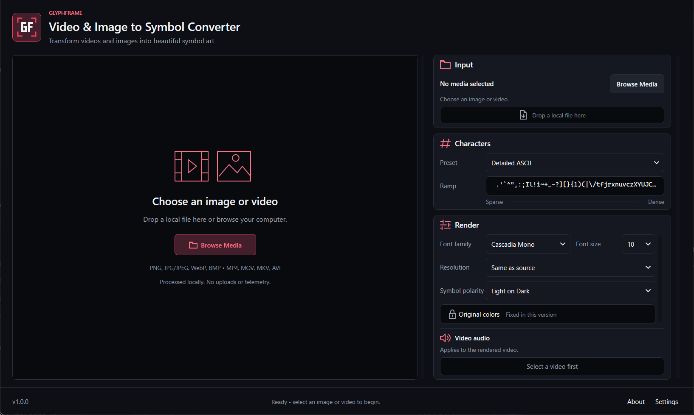
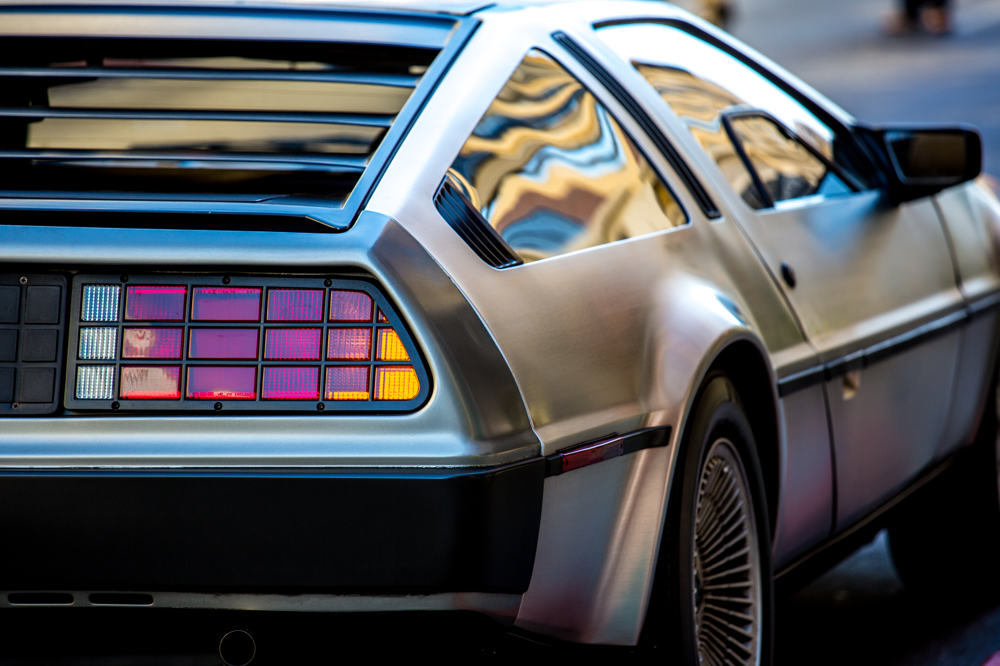
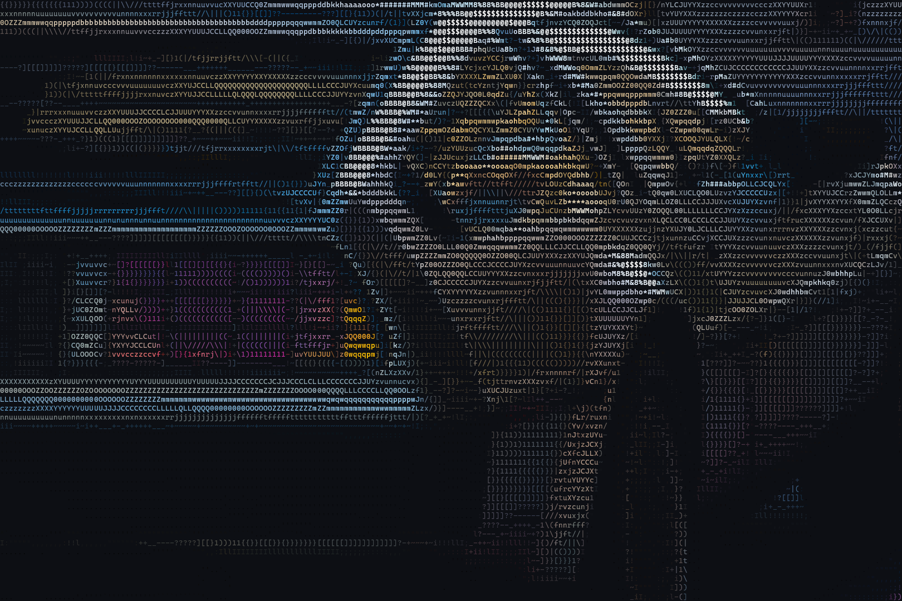
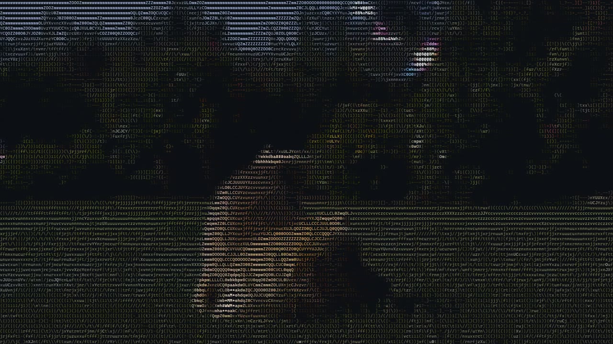
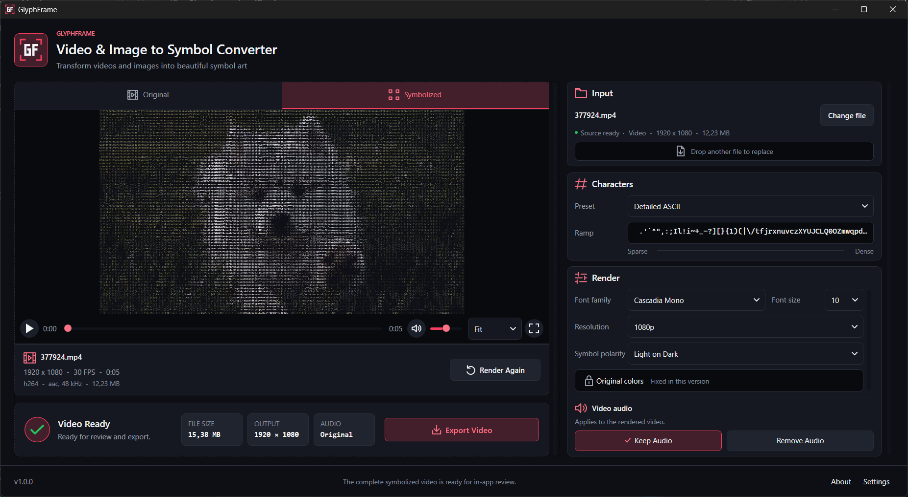
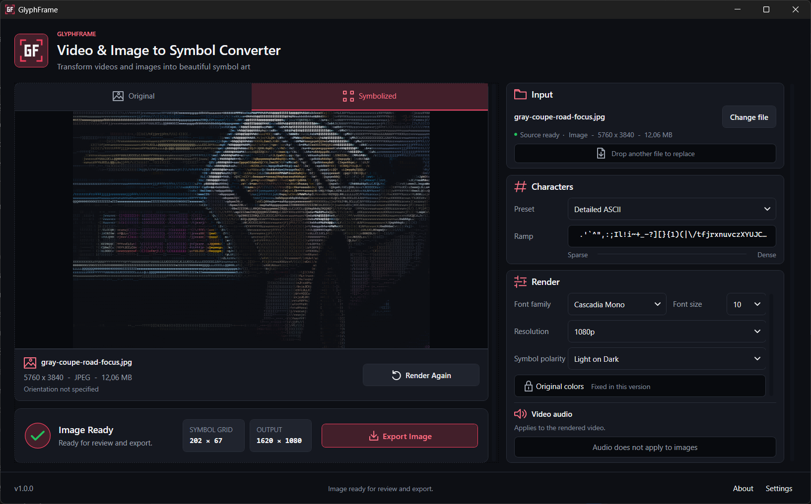
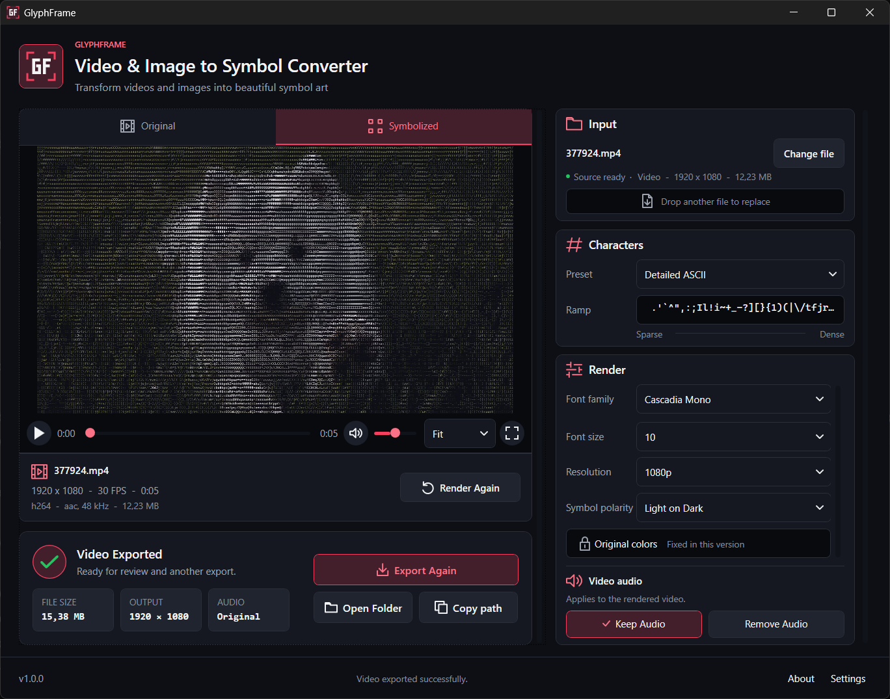

<p align="center">
  
</p>

<h1 align="center">GlyphFrame</h1>

<p align="center">A Windows desktop application that turns local images and videos into colored symbol art.</p>

**Render → Review → Export.** Inspect the generated result before saving it; repeat an export without rerendering. Processing stays on your computer, with no uploads or telemetry.

GlyphFrame is being prepared for **a public repository with development history and separate GitHub Releases for ready-to-run Setup/portable packages**. Git tracks source, tests, project assets, notices and build/installer scripts, not generated EXEs or archives. Release assets remain local candidates until the [publication plan](docs/portfolio.md) and [distribution review](docs/licensing.md) are completed; no public downloads are declared yet.



## Results

### Image conversion

| Original · AI-generated input | Symbolized · GlyphFrame output |
| --- | --- |
|  |  |

### Video conversion

[](docs/screenshots/puppy-symbolized.mp4)

[Open the 5-second MP4 result](docs/screenshots/puppy-symbolized.mp4) · 1080p / 30 FPS. The video opens on demand; it is not an autoplaying application walkthrough. Source footage: [Pixabay, item 371301](https://pixabay.com/videos/ai-generated-puppy-pet-dog-animal-371301/), as identified by the project author. Only the GlyphFrame-symbolized result, prepared for web preview, is provided here; the original clip is not distributed. See [media provenance and owner review](docs/screenshots/README.md).

<details>
<summary>More screenshots</summary>

**Video review and export**



**Image review and export**



**Compact layout after video export**



</details>

## Features

- PNG, JPG/JPEG, WebP and BMP image input; MP4, MOV, MKV and AVI video input.
- Three character presets, measured font-based symbol grids, color-preserving glyphs and two symbol polarities.
- Retained image review with Ctrl + wheel zoom and bounded drag panning; PNG/JPEG export.
- Full-video symbol rendering, independent Original/Symbolized playback, seek, fullscreen and audio controls.
- MP4 export copies the accepted review artifact; Keep Audio and Remove Audio are part of rendering.
- Responsive status/result layouts, six accent presets, reduced-motion behavior and draft-based Settings.
- Recoverable errors, explicit technical Details, bounded local diagnostics and owned-artifact cleanup.

See the [product specification](docs/product-spec.md) for exact formats, controls, data handling and deliberate scope limits.

## Requirements and build

Target platform: **Windows 10/11 x64**. Development requires the **.NET 10 SDK** and access to the configured NuGet sources. WPF application tests also require Windows.

From the repository root:

```powershell
dotnet restore GlyphFrame.sln
dotnet build GlyphFrame.sln -c Release --no-restore
dotnet run --project src/GlyphFrame.App/GlyphFrame.App.csproj -c Release --no-build
```

A fresh source checkout builds without FFmpeg: image workflows are available, while video tooling is reported unavailable. To enable video and the full integration suite, explicitly prepare the pinned local tools with **PowerShell 7**, then rebuild:

```powershell
pwsh -NoProfile -File scripts/Initialize-LocalTools.ps1 -ArchivePath 'C:\GFInputs\GlyphFrame-ffmpeg-9.0-glyphframe.2-win-x64.zip'
dotnet build GlyphFrame.sln -c Release --no-restore
dotnet test GlyphFrame.sln -c Release --no-build --no-restore
```

The initializer accepts only the exact reviewed local controlled-tool archive, checks archive/executable SHA-256 and extracts just FFmpeg/ffprobe into ignored `artifacts/local-runtime/controlled-9.0-glyphframe.2/`. It never executes acquired tools, runs an installer or modifies PATH. There is no public download configured, no automatic vendor fallback and no `-Download` mode. Obtain the reviewed archive from the maintainer; [local setup and verification](Tools/ffmpeg/README.md) explains this pre-publication developer limit. NuGet restore separately obtains the declared .NET dependencies; a source checkout is not dependency-free.

The [offline controlled-tool rebuild](scripts/ffmpeg/README.md) retains source/patch/runtime material for the locally integrated `.2` pair. Functional replay is not bit-identical output; different EXEs need review and new pins. The previous vendor cache/packages remain untouched, and local integration does not declare binary/source-distribution approval.

## Workflow

Open local media → choose characters/font/resolution → render → compare Original/Symbolized → export. Image export offers PNG/JPEG; video export copies the accepted MP4 without encoding it again. See [supported behavior and controls](docs/product-spec.md) for details.

## Architecture and stack

C# / .NET 10, WPF, MVVM with CommunityToolkit.Mvvm, dependency injection, SkiaSharp, MetadataExtractor, System.Text.Json, bundled FFmpeg/ffprobe and xUnit.

Core contracts, rendering, infrastructure and WPF presentation live in separate projects; two test projects cover logic, real-media integration and application components.

[Architecture](docs/architecture.md) explains dependencies, conversion flow, ownership and cancellation. [ADR 0001](docs/decisions/0001-native-video-playback.md) explains why independent players share WPF primitives and retain an FFmpeg fallback rather than adding another media runtime or source proxies.

## Verification and compatibility

Clean-source verification of private commit `e43fada`: **1,288 Release tests**, **141 separate helper checks**, zero-warning/error application builds and formatting/diff checks. A fresh checkout first built without video tools, then used the exact controlled `.2` pair. Its self-contained ZIP and unsigned Setup verify 445 payloads, 31 legal documents and 9 dependency bindings with `WorkingTreeDirty=false`. Independently extracted startup under the original EXE name, an exclusive session, graceful exit and cleanup passed. Earlier native rendering/playback/export evidence is recorded separately, not claimed as a repeat on these bytes. That baseline did not cover Setup lifecycle or clean-PC acceptance; public distribution remains open. [Testing](docs/testing.md) records scope and limits; later work does not relabel these historical packages.

The current [Microsoft component terms 1.0](docs/packaging.md#adopted-windows-component-terms-10) were explicitly adopted for five bundled Microsoft components, not as restrictions on independent MIT/GPL rights. App/Setup require a distinct acceptance scope; old preview records cannot satisfy it. Automated packaging rejects invalid-scope startup and checks pending/decline without synthesizing agreement; the owner's [scoped first-use/restart/render/export and Setup-decline retest](docs/testing.md#owner-reported-edition-10-retest) passed as USER-REPORTED evidence. New Setup installation/interoperability remains separate. The owner's completed [other-PC preview protocol](docs/testing.md#other-pc-manual-preview-protocol) retains its historical package identity, not runtime-free, all-DPI or current-release certification. Public distribution approval remains open.

Continuous playback depends on Windows media components/codecs, and long media/cache paths can prevent WPF review even when an accepted MP4 remains exportable. Batch processing, realtime conversion, GPU controls and GIF/WebM export are outside the current scope. See [product limits](docs/product-spec.md).

## Packaging

The target is self-contained portable ZIP and English per-user x64 Setup downloads in **GitHub Releases**, with the controlled FFmpeg/ffprobe pair bundled inside. End users should not need to install .NET or FFmpeg separately; developer tool acquisition above is not an end-user setup step. Current candidates are unsigned and local, **not cleared public downloads**. Corresponding tool source/build materials and notices will accompany the selected release route. See [packaging](docs/packaging.md) for verification and installation/update/uninstall policy; the scripts do not sign, tag or upload a release.

## Privacy and third-party software

Source media is opened read-only. Processing, settings and managed review artifacts stay local; the application does not upload media or send telemetry. See [data handling](docs/product-spec.md) for storage, diagnostics and cleanup behavior.

Original GlyphFrame code is [MIT-licensed](LICENSE), Copyright (c) 2026 Nazar Khozin (kranel-argonavt). Third-party components retain their own licenses; see [notices](THIRD_PARTY_NOTICES.md) and [open binary-distribution gates](docs/licensing.md). No Setup/ZIP release is declared.

Demonstration media has separate provenance; the code's MIT license does not relicense Pixabay footage. See [media notes](docs/screenshots/README.md).

## Documentation

- [Product specification](docs/product-spec.md) — supported behavior, workflow and scope.
- [Architecture](docs/architecture.md) — project boundaries, processing flow and ownership.
- [Testing](docs/testing.md) — commands, coverage, recorded results and limitations.
- [Packaging](docs/packaging.md) — self-contained builds, extracted validation and candidate identity.
- [Licensing](docs/licensing.md) — code license, dependency texts, version binding and open distribution gates.
- [Publication preparation](docs/portfolio.md) — history-preserving repository, separate release assets, the unselected history-free fallback and approval boundaries.
- [ADR 0001: native video playback](docs/decisions/0001-native-video-playback.md) — decision, alternatives and compatibility evidence.
- [Changelog](CHANGELOG.md) — concise user-visible work, not iteration journals.
- [Test media fixtures](tests/GlyphFrame.Tests/TestInfrastructure/MediaFixtures.md) — synthetic fixture provenance and reproduction.

Full development specifications and dated iteration/acceptance journals are preserved in local archives. Public documentation describes the current product and its engineering decisions without requiring those archives.
