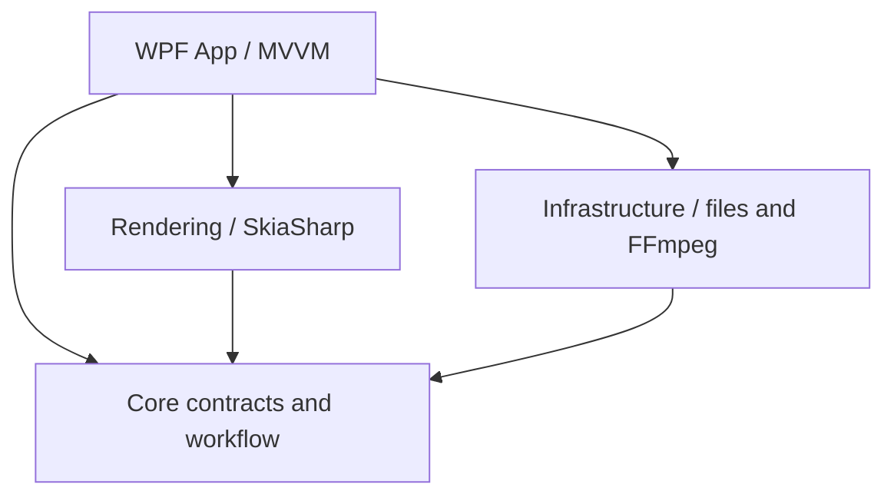
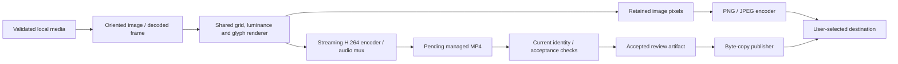

# Architecture

GlyphFrame is a .NET 10 / WPF application organized around a shared symbol-rendering core and explicit media ownership. The UI coordinates workflows; it does not implement a codec or encode video in the player.

The source repository contains no FFmpeg executables. An explicit developer acquisition step populates ignored `artifacts/local-runtime/`; MSBuild copies available tools into the existing application-relative `Tools/ffmpeg/` runtime layout. Production tool discovery is unchanged. Fresh source builds without tools support image workflows and report video tools unavailable; full media tests/local packages require initialization. See [tool setup](../Tools/ffmpeg/README.md).

## Project boundaries

| Project | Responsibility | Project dependencies |
| --- | --- | --- |
| GlyphFrame.Core | Models, settings catalog, presets, interfaces, render identities and workflow rules | None |
| GlyphFrame.Rendering | SkiaSharp decoding, glyph measurement, grid/luminance mapping, symbol rendering and image export | Core |
| GlyphFrame.Infrastructure | Input validation/metadata, JSON settings/paths, FFmpeg processes, streaming video, managed artifacts and publication | Core |
| GlyphFrame.App | WPF views, MVVM presentation, Windows playback, settings/theme coordination and dependency injection | Core, Rendering, Infrastructure |
| GlyphFrame.Tests | Core/rendering/infrastructure unit and real-media integration tests | Core, Rendering, Infrastructure |
| GlyphFrame.App.Tests | Windows application/ViewModel and WPF component tests | App and its referenced projects |

Dependencies point toward Core. `App.xaml.cs` is the composition root; interfaces provide testable boundaries for storage, clipboard, dialogs, media processes and playback.

## Conversion and publication

The image and video paths share [FrameToSymbolConverter](../src/GlyphFrame.Rendering/Conversion/FrameToSymbolConverter.cs) and the Rendering components behind its interfaces. Video input arrives through bounded binary pipes, not temporary frame files. [StreamingVideoExportService](../src/GlyphFrame.Infrastructure/Media/StreamingVideoExportService.cs) coordinates sequential decoding, symbol rendering, encoding and audio handling.

Rendering and publication are separate operations. [ManagedVideoRenderService](../src/GlyphFrame.Infrastructure/Media/ManagedVideoRenderService.cs) produces a candidate in the managed session. [VideoArtifactPublisher](../src/GlyphFrame.Infrastructure/Media/VideoArtifactPublisher.cs) publishes an already accepted MP4 without invoking rendering again.

## Ownership and cancellation invariants

| Resource | Ownership rule |
| --- | --- |
| User input | Borrowed read-only; never renamed, edited or removed by the workflow |
| Decoded frames and image results | Explicit owned lifetime; replaced/obsolete results are disposed rather than leaked |
| Pending video | Owned by the current managed session; rejected, cancelled or superseded work is cleaned up |
| Accepted video | At most one accepted artifact per application session; player borrows it, store owns it |
| Export partial | Publisher-owned file in the destination directory; cleaned on pre-commit failure/cancellation |
| Existing export | Preserved until successful final commit; overwrite requires current confirmation/validation |
| Another live instance | Its leased session is skipped by recovery; never treated as orphaned merely because it exists |

The [managed store](../src/GlyphFrame.Infrastructure/Media/ManagedVideoArtifactStore.cs) and session validate canonical cache-contained paths. Exclusive leases distinguish active sessions from recoverable stale sessions. Playback handles are stopped/closed before artifact replacement or deletion. Cleanup failures retain diagnostics and can be retried at later lifecycle boundaries.

Cancellation is cooperative across processes, pipeline stages and publication. UI cancellation is not a claim that cleanup has already completed. Atomic publication has a point after which cancellation cannot turn successful output into a cancelled result.

## Identity and asynchronous work

Media generations, operation identity and immutable render settings prevent late asynchronous results from replacing current state. A full-video identity includes source/settings/audio, not preview seek position. View-only navigation and export destinations are independent of render identity.

Accepted results are retained across recoverable failed/cancelled retries. Settings changes can make an artifact stale without deleting its useful review file. Selection acceptance, result notifications and cleanup are ordered so a new source cannot display the previous result as its own.

## Playback boundary

[MediaPlaybackController](../src/GlyphFrame.App/Services/MediaPlaybackController.cs) shares transport/lifetime behavior over separate WPF backends. Original and Rendered player facades have independent state and ownership. [VideoPlaybackCoordinator](../src/GlyphFrame.App/Services/VideoPlaybackCoordinator.cs) coordinates comparison and single-audio playback; fullscreen surfaces borrow the current player rather than creating an unrelated stream.

Windows playback is capability-gated. Bundled-FFmpeg frame preview remains available when Original cannot play. Paused timestamp ownership, seek-slider synchronization, generation checks and unloading cleanup protect tab/fullscreen transitions. See [ADR 0001](decisions/0001-native-video-playback.md) for alternatives, compatibility evidence and consequences.

## Presentation, settings and errors

ViewModels expose workflow state and commands; measured WPF panels choose responsive compositions from actual content/space. Navigation state is view-only. Shared vector resources retain live accent behavior, while native window icons use private drawing contexts.

[ApplicationSettingsManager](../src/GlyphFrame.App/Services/ApplicationSettingsManager.cs) separates a Settings draft from saved/current preferences. [JsonSettingsService](../src/GlyphFrame.Infrastructure/Settings/JsonSettingsService.cs) handles normalized recovery and durable replacement. A failed Save must not publish a partially applied draft.

Errors carry stable code/context, friendly guidance and optional technical details. Playback, rendering, publication and input failures do not share one mutable diagnostic identity. Generation/lifetime guards also reject late Copy feedback. Local logging records bounded privacy-safe identifiers, not paths or raw exception text.

## Architectural trade-offs

- WPF/Windows playback avoids an additional media runtime but inherits codec, clock and long-path limitations.
- A retained managed MP4 uses disk space but permits complete in-app review and byte-identical repeated export without rerendering.
- Process-based FFmpeg keeps codecs outside the UI/rendering implementation; bounded pipes, stderr draining and cancellation/cleanup are explicit infrastructure responsibilities.
- Measured UI layouts accommodate changing state/text rather than relying on one fixed window breakpoint; automated geometry still does not replace native environment checks.

Behavioral scope is in the [product specification](product-spec.md). [Testing](testing.md) documents how these boundaries are verified.
